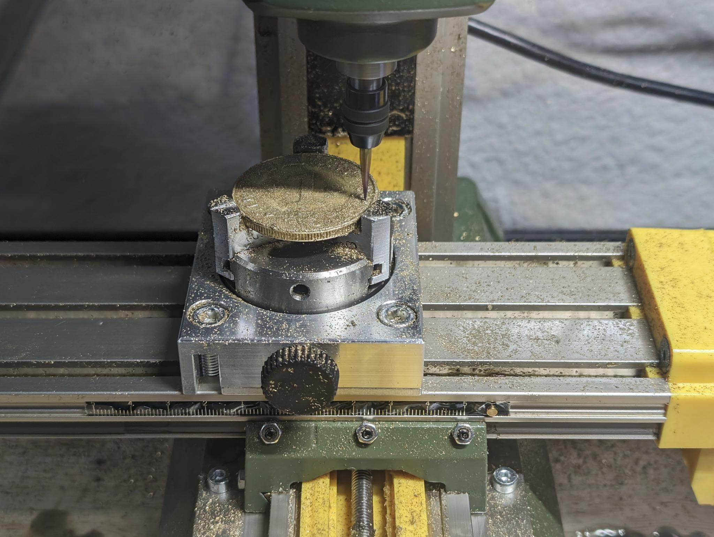

## From a mini-mill to CNC

Big Yellow converts a Proxxon MF70 mini-mill into a CNC machine using 3D-printed parts and off-the-shelf hardware. The conversion extends the Y-axis travel from 46 to 90 mm and adds 15 mm to the Z axis.

The project grew out of a desire to make small objects in metal and wood, beyond what a home 3D printer could produce. The resulting machine fits inside an enclosure about the size of a typical 3D printer.

The repository includes printable parts, a hardware list, and illustrated assembly instructions.
